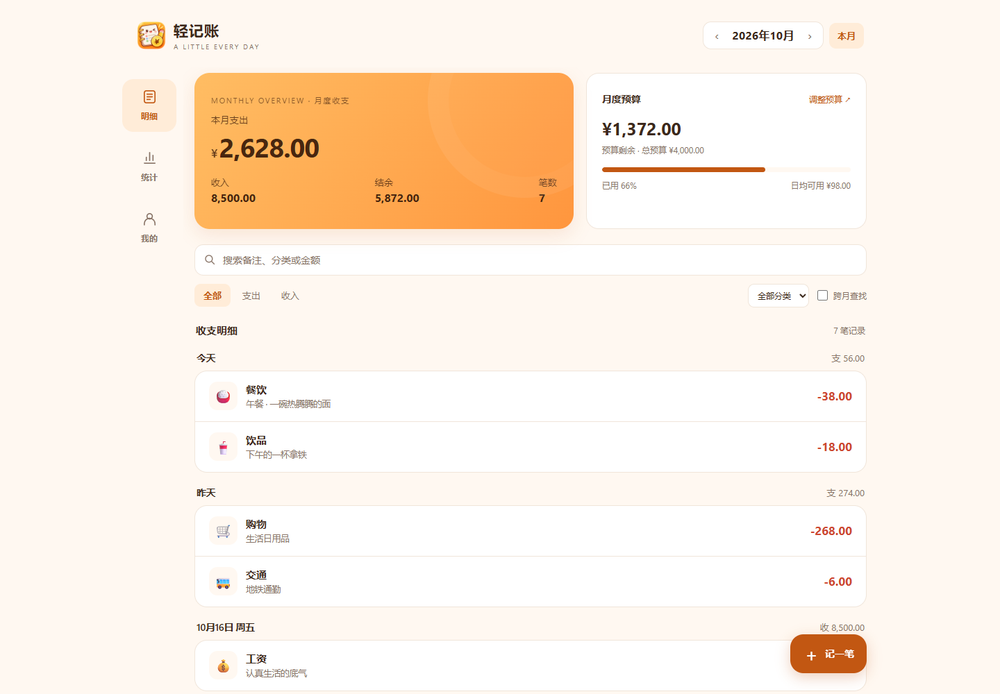

# 轻记账

一个**无需账号、无需后端、支持离线使用**的极简记账本。通过 HTTPS 静态托管部署后，
可从手机浏览器安装到桌面；账目保存在当前设备的浏览器本地存储中，不会上传到服务器。

当前版本 **1.5.8**：为安卓 1.2.1 简化指纹界面，不提供系统指纹设置入口；网页版继续使用原 PIN 密码锁，保留放大镜搜索与紧凑账目行。完整改动见 [CHANGELOG.md](CHANGELOG.md)。

本目录是统一仓库中的 Web / PWA 子项目。`.git` 在上一级 `MoneyBook/`，与同级 `android/` 一起管理。
下文 Web 开发命令在 `web/` 内运行；也可在仓库根目录使用 `node web/脚本名.mjs`。
仓库总览见 [项目入口](../README.md)，两端更新约定见 [管理说明](../docs/PROJECT_MANAGEMENT.md)。

## 一、通过 HTTPS 静态托管安装

安装流程：**部署静态文件 → 打开 HTTPS 网址 → 安装到手机桌面**。
部署完成后，日常使用无需电脑开机，也无需手机与电脑连接同一 Wi-Fi。

### 1. 部署到 GitHub Pages（推荐）

本仓库使用根目录的 [Web 工作流](../.github/workflows/web-pages.yml)，
自动打包并检查 `web/`，只将 `web/dist/` 的内容发布到原站点根路径。

1. 打开 [GitHub 仓库](https://github.com/PPjh/moneyBook)；使用自己的账号部署时，先 Fork 或将项目推送到自己的仓库。
2. 进入仓库的 **Settings → Pages**。
3. 在 **Build and deployment** 下，将 **Source** 设为 **GitHub Actions**。
4. 进入 **Actions → Web checks and Pages → Run workflow**，选择 `main` 并运行。
5. 等待 `build` 与 `deploy` 均成功；之后向 `main` 推送 Web 改动时会自动检查和发布。
6. 在 **Settings → Pages** 中复制站点的 **HTTPS 地址**；如可配置 **Enforce HTTPS**，将其开启。

GitHub Free 使用公开仓库发布 Pages；其他套餐的支持范围见
[GitHub Pages 官方说明](https://docs.github.com/en/pages/getting-started-with-github-pages/configuring-a-publishing-source-for-your-github-pages-site)。
HTTPS 设置见 [GitHub 官方指南](https://docs.github.com/en/pages/getting-started-with-github-pages/securing-your-github-pages-site-with-https)。

> 请使用 Pages 页面显示的站点地址，而不是 `github.com/...` 仓库地址。
> `web/` 是源码子目录，不是公开网址的一部分。已有站点应保留原网址，不要追加 `/web/`。
> 原来使用 `main / (root)` 的站点，首次必须切换发布来源；详细步骤见 [DEPLOY.md](DEPLOY.md)。

### 2. 在安卓手机上安装

1. 用手机 **Chrome** 打开上一步得到的 **`https://…` 站点地址**。
2. 首次打开时保持联网，等待页面和离线资源加载完成。
3. 点击浏览器右上角菜单，选择 **「安装应用」**；部分版本会显示 **「添加到主屏幕 → 安装」**，按提示确认。
4. 从桌面的「轻记账」图标打开应用，开始记账。
5. 可以在联网打开成功后开启飞行模式，再从桌面图标重开，确认离线记账正常。

若只创建了普通网页快捷方式、打开后仍有浏览器地址栏，请确认使用的是 HTTPS 站点，
再按浏览器提供的安装流程操作。不同浏览器的安装入口可能不同，参考
[PWA 安装说明](https://web.dev/learn/pwa/installation/)。

### 其他 HTTPS 静态托管平台

使用 Cloudflare Pages 或 Netlify 时，先在 `web/` 内运行：

```bash
node build.mjs
```

生成的 `dist/`（即仓库中的 `web/dist/`）包含以下 7 个文件，**`index.html` 必须位于上传目录的根目录**：

```text
dist/
├── index.html
├── manifest.json
├── sw.js
├── icon-192.png
├── icon-512.png
├── icon-maskable-512.png
└── .nojekyll
```

- **Cloudflare Pages**：进入 **Workers & Pages**，创建应用时选择 Pages 的直接上传 / 拖放文件入口，
  上传整个 `dist` 文件夹并部署。操作见 [Direct Upload 官方说明](https://developers.cloudflare.com/pages/get-started/direct-upload/)。
- **Netlify Drop**：打开 [Netlify Drop](https://app.netlify.com/drop)，将整个 `dist` 文件夹拖入上传区域。
  操作见 [Netlify 拖放部署说明](https://docs.netlify.com/deploy/create-deploys/#drag-and-drop)。

获得平台分配的 HTTPS 地址后，按上面的安卓安装步骤操作。
只需上传应用静态文件，账目备份 JSON 不属于部署文件。

## 二、功能



**我的**

- **总结余**（全部收入 − 全部支出），正数绿色、负数红色
- 累计收入 / 累计支出 / 记账天数 / 累计笔数
- 密码锁、自动锁定、自动快照与导出、本机快照、清空数据
- 页面最底部显示当前**版本号**（由 `APP_VERSION` 常量渲染）

**明细**

- 点击“收支明细”旁的放大镜搜索备注、分类或金额；默认不显示输入框。搜索后按搜索键、点关闭或空白处收起，仍保留关键词及图标提示，点“清除”恢复全部匹配范围。
- 顶部月份切换，卡片显示本月支出 / 收入 / 结余 / 笔数
- 流水按天分组，每天有小计
- 点任意一条即可编辑，编辑页可删除
- 按关键词 / 收支类型 / 分类筛选，支持跨月查找；长列表每次加载 100 条
- 月度预算独立于筛选，始终根据整月支出计算

**记一笔**

- 支出 / 收入切换
- 19 个支出分类（含 数码 / token / 零食 / 饮品）、7 个收入分类（emoji 图标，无需图片资源）
- 金额、日期、备注
- **金额支持算算式**：`12.5+3.8`、`100-25`、`(1+2)*3`，边输边在右侧显示结果，保存时取计算结果
  （需要有能打运算符的键盘；手机数字键盘默认打不出 `+ − × ÷`，只输普通金额不受影响）
- 自动记住上次用的分类
- 支持保存并继续记账；删除后 8 秒内可以撤销

**统计**

- 本月合计、环比上月、日均、最多的一类
- 分类占比环形图 + 图例
- 分类排行条形图
- 近 6 个月支出/收入趋势

**密码锁**

- 4–6 位 PIN，加盐哈希保存（**不存明文**）
- 切到后台超过设定时间自动重新加锁（立即 / 1 分钟 / 5 分钟 / 30 分钟 / 从不）
- 忘记密码只能清空数据（数据本身没有加密，见下方说明）

**备份与恢复**

- **自动快照**（默认开）：每天首次打开自动把当前数据存一份到本机，滚动保留最近 10 份。
  清空数据、导入覆盖之前也会自动留一份，随时可以退回去。
- **固定备份位置**：在「我的 → 备份位置」选择本机文件夹，之后的手动和自动备份写入同一文件夹；位置会被记住，可以随时更换。
- **自动备份**（默认每周）：打开 App 或解锁时检查周期，授权有效时直接写入所选文件夹。
  可改成 每天 / 每周 / 每月 / 关闭。应用关闭期间不会在后台定时写文件。
- **立即备份**：保存一份带日期、秒和毫秒的 JSON 文件；写入完成后才更新成功时间，历史备份不会主动覆盖或删除。
- **另外下载一份**：临时导出 JSON 文件，不改变固定位置；浏览器不支持文件夹访问时可继续使用普通下载。
- **从文件恢复**：选一个之前导出的 JSON → 预览（条数、日期范围、支出合计、会新增几条重复几条）
  → 选 **合并导入**（按记录 ID 去重，只补新的）或 **覆盖恢复**（完全替换）。动手前自动留快照。
- **导出 CSV**：带 BOM，Excel / WPS 直接打开不乱码。
- 导出的文件包含记录与月度预算，**不包含 PIN 或备份目录句柄**。

**其他**

- 外观可选跟随系统、浅色、深色
- 适配刘海屏与手势条安全区
- 长列表滚动只在内容区发生，整页不晃

---

### 在安卓手机上设置固定备份文件夹

1. 使用支持目录访问的新版 **Chrome**，打开 HTTPS 站点或已安装的应用。
2. 进入 **「我的 → 备份位置」**，在系统选择器中选择或新建专用文件夹，例如 **「下载 / 轻记账备份」**，并允许访问。
3. 点击 **「立即备份」**，确认提示已备份到所选文件夹。之后的备份会使用同一位置，每次生成独立文件。
4. 到备份周期而需要确认访问时，点 **「立即备份」** 并授权；文件夹已删除或移动时，可点击「备份位置」重新选择。

重开后，浏览器的「待确认访问」状态并不代表目录丢失。尚未到备份周期时，应用保留已记住的位置，
不在页面顶部反复提醒；到期无法完成备份、访问被明确拒绝或写入出错时，才显示需要处理的提示。

应用通过浏览器授权保存目录，不会硬编码手机的绝对路径。授权不足、目录不可用或磁盘空间不足时，
会提示失败并保留上一次成功时间；自动备份不会自行弹出授权对话框。
「停用固定文件夹」会恢复普通下载，保留文件夹中的已有备份。

目录选择取决于浏览器支持和权限；功能不可用时，设置页面会说明并提供下载备份。
参考 [目录选择器兼容性说明](https://developer.mozilla.org/en-US/docs/Web/API/Window/showDirectoryPicker)。

## 三、部署后的更新

- **GitHub Pages**：修改 `web/` 下的应用文件并推送到 `main`，等待 **Web checks and Pages** 工作流的检查与部署成功。
- **Cloudflare Pages / Netlify 手动上传**：重新运行 `node build.mjs`，在原有站点中部署新的 `dist` 文件夹，沿用原来的 HTTPS 地址。
- 手机联网后重新打开应用；出现「发现新版本」提示时，可点击「立即更新」。在「我的」页面底部核对版本号。

正常更新无需重新安装。保持相同的站点地址和浏览器，原有本地账目会继续保留。
更换域名、设备或浏览器前，请先导出备份，再在新环境中恢复。

---

## 四、数据与安全

- 数据存在浏览器的 **localStorage**（`jz.records.v1` / `jz.config.v1`），**只在本机**。
- 清理浏览器数据或换手机后，需要通过文件备份恢复账目；卸载也可能影响本地数据。
  请设置固定备份文件夹，并检查「上次成功备份」时间。换手机时先复制备份文件，再在新手机上「从文件恢复」。
- **本机快照救不了卸载**：它和流水存在同一个地方，清数据会一起没。快照防的是手滑，文件备份防的是意外。
- 自动备份默认**每周**一次，首次设置位置后可点击「立即备份」生成第一份文件。
- 普通下载模式由浏览器决定实际保存位置，可能弹出下载询问或拦截自动下载；请在下载记录中确认文件已保存。
- 密码锁是「防别人随手翻你手机」级别的：PIN 用加盐哈希保存，但**流水数据本身没有加密**，
  能拿到手机文件系统的人仍然可以读到原始数据。真正的加密需要另做（会牺牲轻量性）。
- 完全离线：除了加载自身页面，不会发起任何网络请求，没有统计、没有上报。

---

## 五、开发与自检

项目主要文件：

```text
MoneyBook/web/
├── index.html              应用界面与逻辑
├── manifest.json           PWA 安装清单
├── sw.js                   离线缓存
├── icon-192.png
├── icon-512.png
├── icon-maskable-512.png
├── .nojekyll               GitHub Pages 静态发布标记
├── assets/icon-source.png  图标原图，不随 dist 部署
├── build.mjs               生成 dist 部署目录
├── serve.mjs               本地开发预览
├── gen-icons.mjs           生成应用图标
├── check.mjs               零依赖功能自检
├── browser-check.mjs       可选浏览器回归
├── screenshots/            演示截图
├── CHANGELOG.md            更新日志
├── DEPLOY.md               HTTPS 托管与原站点迁移说明
└── README.md
```

```bash
node check.mjs      # 功能回归：记账/编辑/撤销、搜索、预算、存储失败、密码锁、备份与 PWA
node build.mjs      # 打包出 dist/（可直接上传的静态站点）
node gen-icons.mjs  # 从 assets/icon-source.png 生成三个图标，无第三方依赖
```

`check.mjs` 会把 `index.html` 里的**真实脚本**塞进一个小 DOM 桩里跑，
所以它验证的是真正要发布的那份代码，而不是复制品。

可选的真实浏览器回归：本机已提供 Playwright 和 Microsoft Edge 时，先运行
`node serve.mjs`，在另一个终端运行 `node browser-check.mjs`。
它使用隔离的演示账本，检查不同屏幕宽度、离线重开、多窗口冲突和 1.4.3 升级兼容，
并按当前版本更新 `screenshots/版本号-*.png`。Playwright 只用于开发测试，不属于部署文件。
其他 Chromium 通道可通过 `MONEYBOOK_BROWSER_CHANNEL` 指定，测试站点可通过
`MONEYBOOK_TEST_URL` 指定；升级测试需要本地 Git 历史包含 1.4.3 提交 `0ee95bd`。
只验证、不更新演示截图时，可将 `MONEYBOOK_SCREENSHOT_DIR` 设为临时输出目录，
例如 `playwright-report/screenshots`（在 `web/` 内运行时）。

### 改点什么

| 想改 | 改哪里 |
| --- | --- |
| 分类与 emoji | `index.html` 顶部的 `CATS` 对象（支出/收入各一组，`['名称','emoji']`） |
| 图表配色 | `index.html` 里的 `PALETTE` 数组 |
| 主题色 | `index.html` 的 `:root` 里 `--brand`，以及 `manifest.json` 的 `theme_color` |
| 图标 | 替换 `assets/icon-source.png`（8-bit RGB / RGBA PNG），再运行 `node gen-icons.mjs` |

### 发布新版本

每次发布同步更新 `index.html` 的 `APP_VERSION` 与 `sw.js` 的缓存版本，然后重新打包。
根据上面的 HTTPS 托管方式更新站点，并在手机上核对版本和离线打开情况。
